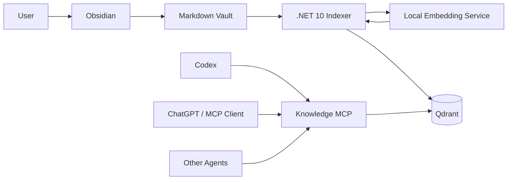
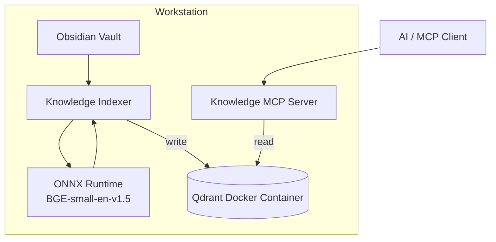
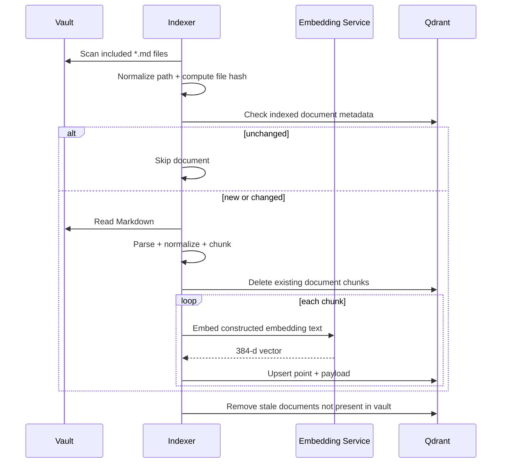
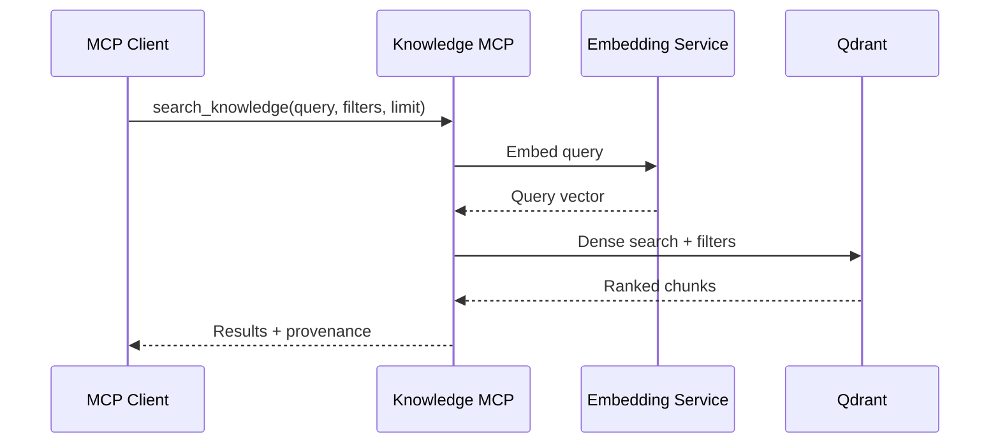

# Solution Architecture

## 1. Executive summary

The Obsidian Knowledge Platform provides local semantic retrieval over an Obsidian Markdown vault for AI clients.

Obsidian remains the human authoring interface and Markdown remains authoritative. A .NET 10 indexer parses Markdown, extracts semantic structure and metadata, creates embedding-ready chunks, generates local embeddings using `BAAI/bge-small-en-v1.5`, and writes those chunks into a local Qdrant instance.

A separate .NET MCP server provides read-only knowledge retrieval to AI clients. The MCP boundary hides retrieval implementation details so dense search can later evolve to hybrid search, reranking, or graph-assisted retrieval without changing the external contract.

## 2. Goals

### 2.1 Primary goals

- Search Obsidian notes semantically using natural language.
- Preserve provenance for every retrieved chunk.
- Preserve Obsidian-specific metadata such as tags, heading hierarchy, and wikilinks.
- Keep all indexing and embedding local by default.
- Support deterministic rebuilds.
- Support incremental indexing at document granularity.
- Expose retrieval through MCP.
- Establish measurable retrieval quality.

### 2.2 Secondary goals

- Preserve a path to hybrid dense + sparse retrieval.
- Preserve a path to multiple vaults.
- Preserve a path to additional knowledge sources.
- Preserve a path to remote or shared hosting without coupling clients to Qdrant.

## 3. Non-goals for the POC

- Graph database.
- GraphRAG framework.
- Reranking model.
- OCR or image understanding.
- Binary attachment indexing.
- Cloud-hosted vector storage.
- Multi-user authorization.
- Agent write-back to Obsidian.
- Real-time filesystem watching.
- Automatic summarization or knowledge extraction.
- Remote MCP exposure.
- Cloud embedding providers.
- Production-grade HA or disaster recovery.

## 4. Context



## 5. Deployment architecture

The initial deployment is single-workstation and local-first.



### 5.1 Network posture

- Qdrant is not intended to be exposed outside the workstation.
- MCP is local-only in the POC.
- No note content is sent to a cloud embedding service.
- External AI clients receive only the context requested through the MCP tool contract.

## 6. Component responsibilities

### 6.1 Obsidian vault

Responsibilities:

- Authoritative storage of notes.
- Human editing experience.
- Markdown structure.
- YAML frontmatter.
- tags.
- `[[wikilinks]]`.

The vault is never treated as a cache of data from Qdrant.

### 6.2 Knowledge Indexer

Responsibilities:

- Discover configured Markdown files.
- Apply include/exclude rules.
- Parse Markdown.
- Parse selected frontmatter.
- Extract heading hierarchy.
- Extract tags, aliases, and wikilinks.
- Normalize Markdown for embedding.
- Create deterministic chunks.
- Generate local embeddings.
- Detect new, changed, unchanged, and deleted documents.
- Write and delete Qdrant points.
- Produce indexing metrics and diagnostics.

The indexer is the **only writer** to Qdrant.

### 6.3 Embedding service

Architecture contract:

```csharp
public interface IEmbeddingService
{
    Task<EmbeddingResult> EmbedAsync(
        string text,
        CancellationToken cancellationToken = default);
}

public sealed record EmbeddingResult(
    ReadOnlyMemory<float> Vector,
    string Provider,
    string Model,
    int Dimensions);
```

Initial implementation:

- Provider: local ONNX Runtime
- Model: `BAAI/bge-small-en-v1.5`
- Dimensions: 384
- Similarity: cosine

The concrete runtime is replaceable.

### 6.4 Qdrant

Responsibilities:

- Store embedding vectors.
- Store chunk payload and retrieval metadata.
- Support dense vector search.
- Support metadata filtering.
- Later support sparse vectors and hybrid retrieval.

Qdrant is disposable derived state.

### 6.5 Knowledge MCP server

Responsibilities:

- Expose stable knowledge-domain retrieval tools.
- Generate query embeddings.
- Execute retrieval.
- Apply filters.
- Return provenance.
- Hide Qdrant, vector dimensions, score mechanics, and future retrieval strategy from clients.

The MCP server is read-only with respect to the knowledge index.

## 7. Data flow

### 7.1 Indexing



### 7.2 Retrieval



## 8. Source-of-truth model

```text
AUTHORITATIVE
    Markdown Vault
         |
         v
      Indexer
         |
         v
DERIVED
       Qdrant
```

The following must always be safe:

```bash
knowledge rebuild
```

Rebuild semantics:

1. Delete or recreate the Qdrant collection.
2. Re-read all included Markdown.
3. Recreate all chunks.
4. Regenerate all embeddings.
5. End with a functionally equivalent retrieval index.

## 9. Indexing strategy

### 9.1 Initial trigger model

The POC uses explicit indexing commands rather than a filesystem watcher.

```bash
knowledge index
knowledge rebuild
knowledge status
```

A future `knowledge watch` command may be added after baseline correctness is established.

### 9.2 Change detection

- Compute a file content hash for each indexed document.
- If the hash is unchanged, skip the document.
- If the hash changes, delete all existing chunks for that document and recreate them.
- If a document disappears from the vault, delete its chunks.
- Chunk-level diffing is intentionally deferred.

This strategy favors correctness and simplicity over micro-optimization.

## 10. Chunking architecture

### 10.1 Governing principle

> A chunk should be the smallest coherent unit that still makes sense when retrieved without the rest of the note.

### 10.2 Preferred size

- Target: approximately 250 to 350 model tokens.
- Soft maximum: approximately 400 model tokens.
- Hard maximum: must fit within the embedding model tokenizer limit.
- The tokenizer, not character count, is authoritative.

### 10.3 Structure hierarchy

1. Split by Markdown heading sections.
2. Keep coherent sections intact when they fit.
3. If oversized, split by paragraph boundaries.
4. Preserve logical lists, tables, blockquotes, and code blocks where practical.
5. Split sentences only as a last resort.
6. Use limited overlap only when an oversized prose section must be divided.

### 10.4 Heading context

Embedding text includes title and full heading hierarchy.

Example:

```text
Title: Azure Authentication
Section: API Authentication > On-Behalf-Of Flow
Tags: azure, authentication

The API exchanges the incoming user token...
```

## 11. Markdown normalization

The system maintains two content forms:

- `contentMarkdown`: original Markdown for retrieval and provenance.
- `contentNormalized`: normalized semantic text used to construct embeddings.

Normalization rules:

- Remove formatting markers that do not change meaning.
- Keep visible text.
- Keep inline code identifiers.
- Keep code content.
- Keep list content.
- Keep table content.
- Convert Obsidian wikilinks to visible text while separately preserving link targets.
- Parse frontmatter rather than embedding YAML verbatim.
- Remove purely presentational HTML.

## 12. Frontmatter policy

Frontmatter is parsed selectively.

Initial semantic fields:

- `tags`
- `aliases`

Initial control field:

- `ai-index: false` excludes a document.

Other frontmatter remains available for future metadata filtering but is not automatically embedded.

## 13. Wikilink policy

For V1:

- Extract target.
- Extract display text.
- Preserve in payload.
- Use display text in normalized content.
- Do not traverse links during retrieval.

Future extension:

```text
semantic results
      |
      v
one-hop wikilink expansion
      |
      v
rerank
```

No graph database is required for the initial implementation.

## 14. Retrieval architecture

### 14.1 Initial implementation

Dense semantic retrieval:

```text
query
  |
  v
BGE embedding
  |
  v
Qdrant cosine search
  |
  v
ranked results
```

### 14.2 Target evolution

Hybrid retrieval is the intended next-stage architecture:

```text
             Query
               |
       +-------+-------+
       |               |
       v               v
   Dense search    Sparse search
       |               |
       +-------+-------+
               |
              RRF
               |
               v
            Results
```

The MCP contract must not change when hybrid retrieval is introduced.

## 15. MCP API

Initial tools:

### `search_knowledge`

Inputs:

- `query` required
- `limit` optional
- `pathPrefix` optional
- `tags` optional

Returns:

- document ID
- note path
- title
- heading path
- original Markdown content
- score
- provenance metadata

### `get_note`

Inputs:

- `path` or `documentId`

Returns the authoritative note content when available.

`get_note` is useful when a search result identifies a relevant note and the caller needs larger context.

## 16. Identity strategy

### 16.1 Vault ID

Every record contains `vaultId`, even though the POC supports one configured vault.

### 16.2 Document ID

Recommended:

```text
SHA256(vaultId + normalized relative path)
```

A rename is treated as delete + add. This is acceptable because the index is derived state.

### 16.3 Chunk ID

Recommended:

```text
SHA256(documentId + headingPath + chunkOrdinal)
```

IDs are deterministic across rebuilds when the logical path and chunk structure remain unchanged.

## 17. Observability

Log:

- files scanned
- files indexed
- files skipped
- files deleted
- chunks created
- chunks deleted
- embedding duration
- Qdrant duration
- query duration
- result count
- document/chunk identifiers

Do not log note content, embedding input, returned chunk text, or vectors by default.

## 18. Failure handling

### Indexing failures

- A single malformed note must not corrupt the collection.
- Report the failing path.
- Continue indexing other notes when safe.
- Use non-zero exit codes when the indexing run is incomplete.
- Never silently treat failed parsing as successful indexing.

### Embedding failure

- Do not write an incomplete chunk.
- Record the chunk/document identifier in diagnostics.
- Allow a later index run to retry.

### Qdrant failure

- Fail the indexing operation.
- Do not modify Markdown.
- The next run may safely retry because the source is authoritative.

## 19. Extensibility

The design intentionally permits future addition of:

- sparse vectors
- RRF
- reranking
- graph-assisted retrieval
- multiple vaults
- additional knowledge sources
- remote Qdrant
- cloud embedding providers
- remote MCP with authentication

None of those are required to prove the POC.

## 20. Architecture decisions

See `adr/` for decision rationale.
