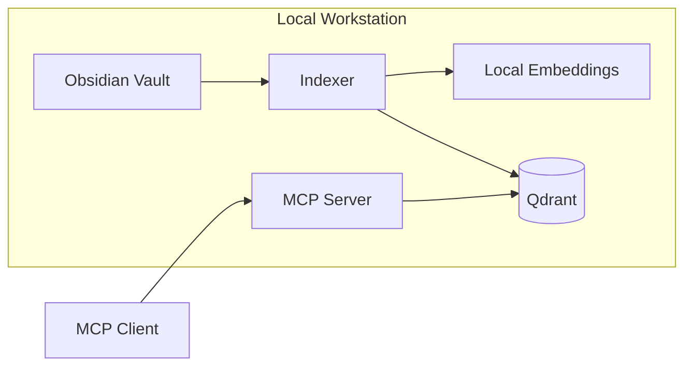

# Security and Privacy

## 1. Security posture

The POC is local-first.

The default principle is:

> No note content leaves the workstation unless the user explicitly adopts a future configuration that permits it.

## 2. Trust boundaries

## 3. Qdrant

Recommended POC posture:

- Local Docker container.
- Do not bind Qdrant to an externally reachable interface unless required.
- Do not expose Qdrant directly to AI clients.
- Only the indexer writes.
- MCP reads.

If remote Qdrant is later adopted, authentication, TLS, firewalling, secrets management, backup, and tenant isolation require a separate architecture decision.

## 4. MCP

POC:

- local-only
- read-only knowledge tools
- no arbitrary filesystem tool
- no write-back tool

`get_note` must:

- resolve inside the configured vault
- reject `..` traversal
- reject absolute paths outside the vault
- follow explicit symlink policy

Recommended POC symlink policy:

> Do not follow symlinks that resolve outside the configured vault root.

## 5. Embeddings

Embedding generation occurs locally.

The embedding provider abstraction must not silently fall back to a cloud service.

A future cloud embedding provider must require explicit configuration.

## 6. Sensitive content

The POC does not attempt automatic sensitivity classification.

The user controls inclusion through:

- path include/exclude rules
- `ai-index: false`

Recommended future enhancement:

- optional folder-level deny rules for sensitive note areas

## 7. Logging

Allowed by default:

- paths
- document IDs
- chunk IDs
- counts
- durations
- model identity
- error codes

Not allowed by default:

- note bodies
- normalized chunk text
- embedding text
- embedding vectors
- search-result bodies
- full user queries when they may contain sensitive content

Recommended query logging:

- disabled or redacted by default
- explicit debug option for local troubleshooting

## 8. Secrets

The POC should not require secrets for local Qdrant or local embeddings.

If future providers require credentials:

- use environment variables or OS secret stores
- do not store secrets in `knowledge.yaml`
- never write secrets to logs

## 9. Binary attachments

V1 does not index attachments.

This avoids introducing:

- OCR
- image model calls
- PDF extraction pipelines
- attachment-content privacy ambiguity

## 10. Threats considered

### Path traversal

Mitigation: canonicalize requested paths and enforce vault-root containment.

### Unintended network exposure

Mitigation: local binding and no public service configuration.

### Content leakage through logs

Mitigation: metadata-only structured logging.

### Index drift

Mitigation: indexer sole-writer model and rebuildability.

### Stale deleted content

Mitigation: stale-document deletion during indexing.

### Agent modification of knowledge

Mitigation: MCP exposes no write operations in the POC.

### Prompt injection inside notes

The retrieval system may return untrusted text from notes. AI clients should treat retrieved note text as data, not instructions.

MCP responses should preserve provenance and should not label note content as system instructions.

## 11. Deferred security decisions

Required only if moving beyond local single-user operation:

- MCP authentication
- remote authorization
- TLS
- multi-user isolation
- secret management
- audit logging
- hosted backups
- data residency
- enterprise compliance
