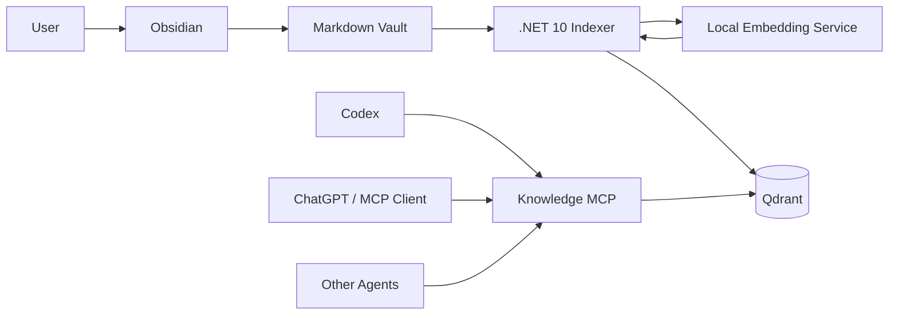
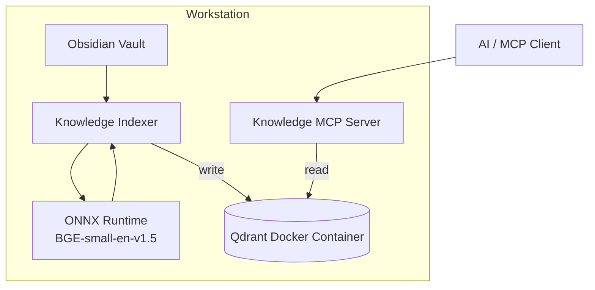
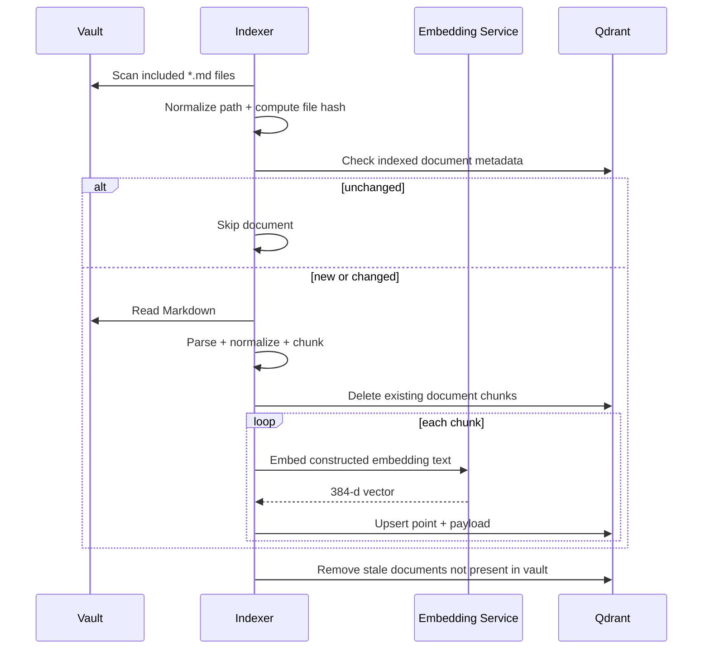
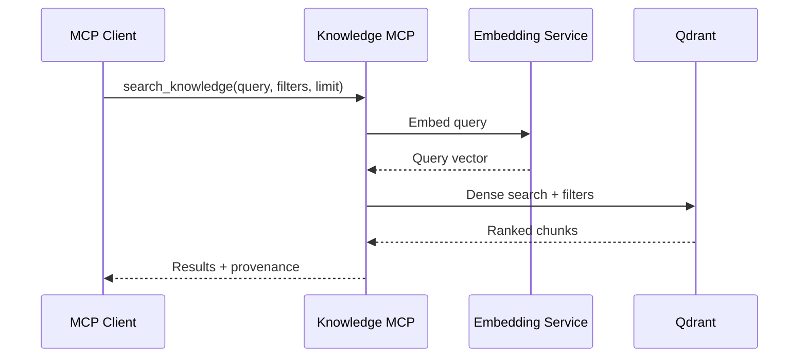
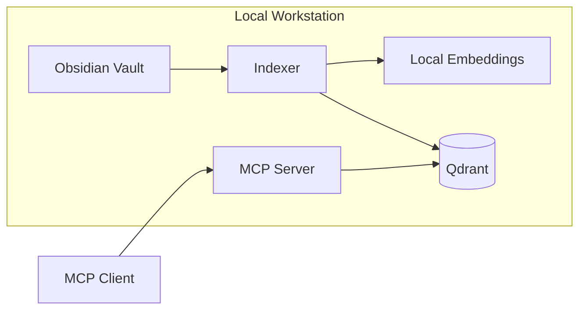

<!-- SOURCE: 00-README.md -->

# Obsidian Knowledge Platform

## Purpose

The Obsidian Knowledge Platform is a local-first knowledge retrieval system that indexes an Obsidian Markdown vault and exposes semantic search to AI clients through MCP.

The initial objective is deliberately narrow:

> Given an Obsidian vault containing Markdown files, create a searchable semantic index and expose it through an MCP server so an AI client can retrieve relevant note sections using natural-language queries with provenance.

## Status

Architecture baseline: **Approved for POC implementation**

The documentation in this package reflects the decisions reached during architecture discussions and resolves remaining ambiguities with recommended defaults.

## Governing principles

1. **Markdown is the source of truth.**
2. **Qdrant is derived state and must be rebuildable.**
3. **The indexer is the only writer to Qdrant.**
4. **MCP exposes knowledge-domain operations, not database mechanics.**
5. **No note content leaves the workstation by default.**
6. **Retrieval quality is measured, not judged only by intuition.**
7. **Start simple, preserve extension points, and add retrieval sophistication only when evaluation proves value.**

## Document set

| Document | Purpose |
|---|---|
| `01-solution-architecture.md` | End-to-end system architecture and component responsibilities |
| `02-poc-specification.md` | POC scope, functional requirements, NFRs, and acceptance criteria |
| `03-domain-and-data-contracts.md` | Canonical document/chunk/query/result contracts |
| `04-retrieval-evaluation-plan.md` | Retrieval benchmark and evaluation approach |
| `05-implementation-plan.md` | Milestones, work breakdown, and delivery sequence |
| `06-security-and-privacy.md` | Local-first security boundary and privacy requirements |
| `07-configuration-reference.md` | Proposed configuration model |
| `08-open-questions-and-assumptions.md` | Ambiguities, defaults, and deferred decisions |
| `adr/` | Architecture Decision Records |

## Initial technology baseline

- .NET 10
- Qdrant, local Docker deployment
- `BAAI/bge-small-en-v1.5`
- ONNX Runtime for local embedding inference
- 384-dimensional dense vectors
- Cosine similarity
- Dense semantic search for the initial POC
- Hybrid dense + sparse retrieval planned after baseline evaluation
- MCP as the AI-facing retrieval boundary

## Proposed repository layout

```text
obsidian-knowledge-platform/
├── src/
│   ├── Knowledge.Core/
│   ├── Knowledge.Markdown/
│   ├── Knowledge.Embeddings/
│   ├── Knowledge.Qdrant/
│   ├── Knowledge.Indexer/
│   └── Knowledge.Mcp/
├── tests/
│   ├── Knowledge.Core.Tests/
│   ├── Knowledge.Markdown.Tests/
│   ├── Knowledge.Indexing.Tests/
│   └── Knowledge.Retrieval.Tests/
├── eval/
│   └── retrieval-benchmark.json
├── docs/
│   ├── adr/
│   └── ...
├── docker/
│   └── docker-compose.yml
└── knowledge.yaml
```

## POC definition of done

The POC is complete when:

1. A configured Obsidian vault can be indexed into Qdrant.
2. Re-running indexing skips unchanged files.
3. Changed files are safely reindexed.
4. Deleted files are removed from the index.
5. Natural-language queries return relevant chunks with provenance.
6. The same retrieval capability is exposed through MCP.
7. A benchmark set demonstrates that expected notes appear in the top five results at an agreed baseline rate.
8. The entire Qdrant collection can be deleted and rebuilt from Markdown without loss of authoritative knowledge.


<!-- SOURCE: 01-solution-architecture.md -->

# Solution Architecture

## 1. Executive summary

The Obsidian Knowledge Platform provides local semantic retrieval over an Obsidian Markdown vault for AI clients.

Obsidian remains the human authoring interface and Markdown remains authoritative. A .NET 10 indexer parses Markdown, extracts semantic structure and metadata, creates embedding-ready chunks, generates local embeddings using `BAAI/bge-small-en-v1.5`, and writes those chunks into a local Qdrant instance.

A separate .NET MCP server provides read-only knowledge retrieval to AI clients. The MCP boundary hides retrieval implementation details so dense search can later evolve to hybrid search, reranking, or graph-assisted retrieval without changing the external contract.

## 2. Goals

### 2.1 Primary goals

- Search Obsidian notes semantically using natural language.
- Preserve provenance for every retrieved chunk.
- Preserve Obsidian-specific metadata such as tags, heading hierarchy, and wikilinks.
- Keep all indexing and embedding local by default.
- Support deterministic rebuilds.
- Support incremental indexing at document granularity.
- Expose retrieval through MCP.
- Establish measurable retrieval quality.

### 2.2 Secondary goals

- Preserve a path to hybrid dense + sparse retrieval.
- Preserve a path to multiple vaults.
- Preserve a path to additional knowledge sources.
- Preserve a path to remote or shared hosting without coupling clients to Qdrant.

## 3. Non-goals for the POC

- Graph database.
- GraphRAG framework.
- Reranking model.
- OCR or image understanding.
- Binary attachment indexing.
- Cloud-hosted vector storage.
- Multi-user authorization.
- Agent write-back to Obsidian.
- Real-time filesystem watching.
- Automatic summarization or knowledge extraction.
- Remote MCP exposure.
- Cloud embedding providers.
- Production-grade HA or disaster recovery.

## 4. Context



## 5. Deployment architecture

The initial deployment is single-workstation and local-first.



### 5.1 Network posture

- Qdrant is not intended to be exposed outside the workstation.
- MCP is local-only in the POC.
- No note content is sent to a cloud embedding service.
- External AI clients receive only the context requested through the MCP tool contract.

## 6. Component responsibilities

### 6.1 Obsidian vault

Responsibilities:

- Authoritative storage of notes.
- Human editing experience.
- Markdown structure.
- YAML frontmatter.
- tags.
- `[[wikilinks]]`.

The vault is never treated as a cache of data from Qdrant.

### 6.2 Knowledge Indexer

Responsibilities:

- Discover configured Markdown files.
- Apply include/exclude rules.
- Parse Markdown.
- Parse selected frontmatter.
- Extract heading hierarchy.
- Extract tags, aliases, and wikilinks.
- Normalize Markdown for embedding.
- Create deterministic chunks.
- Generate local embeddings.
- Detect new, changed, unchanged, and deleted documents.
- Write and delete Qdrant points.
- Produce indexing metrics and diagnostics.

The indexer is the **only writer** to Qdrant.

### 6.3 Embedding service

Architecture contract:

```csharp
public interface IEmbeddingService
{
    Task<EmbeddingResult> EmbedAsync(
        string text,
        CancellationToken cancellationToken = default);
}

public sealed record EmbeddingResult(
    ReadOnlyMemory<float> Vector,
    string Provider,
    string Model,
    int Dimensions);
```

Initial implementation:

- Provider: local ONNX Runtime
- Model: `BAAI/bge-small-en-v1.5`
- Dimensions: 384
- Similarity: cosine

The concrete runtime is replaceable.

### 6.4 Qdrant

Responsibilities:

- Store embedding vectors.
- Store chunk payload and retrieval metadata.
- Support dense vector search.
- Support metadata filtering.
- Later support sparse vectors and hybrid retrieval.

Qdrant is disposable derived state.

### 6.5 Knowledge MCP server

Responsibilities:

- Expose stable knowledge-domain retrieval tools.
- Generate query embeddings.
- Execute retrieval.
- Apply filters.
- Return provenance.
- Hide Qdrant, vector dimensions, score mechanics, and future retrieval strategy from clients.

The MCP server is read-only with respect to the knowledge index.

## 7. Data flow

### 7.1 Indexing



### 7.2 Retrieval



## 8. Source-of-truth model

```text
AUTHORITATIVE
    Markdown Vault
         |
         v
      Indexer
         |
         v
DERIVED
       Qdrant
```

The following must always be safe:

```bash
knowledge rebuild
```

Rebuild semantics:

1. Delete or recreate the Qdrant collection.
2. Re-read all included Markdown.
3. Recreate all chunks.
4. Regenerate all embeddings.
5. End with a functionally equivalent retrieval index.

## 9. Indexing strategy

### 9.1 Initial trigger model

The POC uses explicit indexing commands rather than a filesystem watcher.

```bash
knowledge index
knowledge rebuild
knowledge status
```

A future `knowledge watch` command may be added after baseline correctness is established.

### 9.2 Change detection

- Compute a file content hash for each indexed document.
- If the hash is unchanged, skip the document.
- If the hash changes, delete all existing chunks for that document and recreate them.
- If a document disappears from the vault, delete its chunks.
- Chunk-level diffing is intentionally deferred.

This strategy favors correctness and simplicity over micro-optimization.

## 10. Chunking architecture

### 10.1 Governing principle

> A chunk should be the smallest coherent unit that still makes sense when retrieved without the rest of the note.

### 10.2 Preferred size

- Target: approximately 250 to 350 model tokens.
- Soft maximum: approximately 400 model tokens.
- Hard maximum: must fit within the embedding model tokenizer limit.
- The tokenizer, not character count, is authoritative.

### 10.3 Structure hierarchy

1. Split by Markdown heading sections.
2. Keep coherent sections intact when they fit.
3. If oversized, split by paragraph boundaries.
4. Preserve logical lists, tables, blockquotes, and code blocks where practical.
5. Split sentences only as a last resort.
6. Use limited overlap only when an oversized prose section must be divided.

### 10.4 Heading context

Embedding text includes title and full heading hierarchy.

Example:

```text
Title: Azure Authentication
Section: API Authentication > On-Behalf-Of Flow
Tags: azure, authentication

The API exchanges the incoming user token...
```

## 11. Markdown normalization

The system maintains two content forms:

- `contentMarkdown`: original Markdown for retrieval and provenance.
- `contentNormalized`: normalized semantic text used to construct embeddings.

Normalization rules:

- Remove formatting markers that do not change meaning.
- Keep visible text.
- Keep inline code identifiers.
- Keep code content.
- Keep list content.
- Keep table content.
- Convert Obsidian wikilinks to visible text while separately preserving link targets.
- Parse frontmatter rather than embedding YAML verbatim.
- Remove purely presentational HTML.

## 12. Frontmatter policy

Frontmatter is parsed selectively.

Initial semantic fields:

- `tags`
- `aliases`

Initial control field:

- `ai-index: false` excludes a document.

Other frontmatter remains available for future metadata filtering but is not automatically embedded.

## 13. Wikilink policy

For V1:

- Extract target.
- Extract display text.
- Preserve in payload.
- Use display text in normalized content.
- Do not traverse links during retrieval.

Future extension:

```text
semantic results
      |
      v
one-hop wikilink expansion
      |
      v
rerank
```

No graph database is required for the initial implementation.

## 14. Retrieval architecture

### 14.1 Initial implementation

Dense semantic retrieval:

```text
query
  |
  v
BGE embedding
  |
  v
Qdrant cosine search
  |
  v
ranked results
```

### 14.2 Target evolution

Hybrid retrieval is the intended next-stage architecture:

```text
             Query
               |
       +-------+-------+
       |               |
       v               v
   Dense search    Sparse search
       |               |
       +-------+-------+
               |
              RRF
               |
               v
            Results
```

The MCP contract must not change when hybrid retrieval is introduced.

## 15. MCP API

Initial tools:

### `search_knowledge`

Inputs:

- `query` required
- `limit` optional
- `pathPrefix` optional
- `tags` optional

Returns:

- document ID
- note path
- title
- heading path
- original Markdown content
- score
- provenance metadata

### `get_note`

Inputs:

- `path` or `documentId`

Returns the authoritative note content when available.

`get_note` is useful when a search result identifies a relevant note and the caller needs larger context.

## 16. Identity strategy

### 16.1 Vault ID

Every record contains `vaultId`, even though the POC supports one configured vault.

### 16.2 Document ID

Recommended:

```text
SHA256(vaultId + normalized relative path)
```

A rename is treated as delete + add. This is acceptable because the index is derived state.

### 16.3 Chunk ID

Recommended:

```text
SHA256(documentId + headingPath + chunkOrdinal)
```

IDs are deterministic across rebuilds when the logical path and chunk structure remain unchanged.

## 17. Observability

Log:

- files scanned
- files indexed
- files skipped
- files deleted
- chunks created
- chunks deleted
- embedding duration
- Qdrant duration
- query duration
- result count
- document/chunk identifiers

Do not log note content, embedding input, returned chunk text, or vectors by default.

## 18. Failure handling

### Indexing failures

- A single malformed note must not corrupt the collection.
- Report the failing path.
- Continue indexing other notes when safe.
- Use non-zero exit codes when the indexing run is incomplete.
- Never silently treat failed parsing as successful indexing.

### Embedding failure

- Do not write an incomplete chunk.
- Record the chunk/document identifier in diagnostics.
- Allow a later index run to retry.

### Qdrant failure

- Fail the indexing operation.
- Do not modify Markdown.
- The next run may safely retry because the source is authoritative.

## 19. Extensibility

The design intentionally permits future addition of:

- sparse vectors
- RRF
- reranking
- graph-assisted retrieval
- multiple vaults
- additional knowledge sources
- remote Qdrant
- cloud embedding providers
- remote MCP with authentication

None of those are required to prove the POC.

## 20. Architecture decisions

See `adr/` for decision rationale.


<!-- SOURCE: 02-poc-specification.md -->

# POC Specification

## 1. Purpose

This specification defines the initial proof of concept for the Obsidian Knowledge Platform.

## 2. POC objective

Demonstrate that an Obsidian Markdown vault can be indexed locally into Qdrant and queried semantically through both a CLI and MCP with useful provenance and measurable retrieval quality.

## 3. Scope

### Included

- One configured Obsidian vault.
- Recursive Markdown discovery.
- Configurable include/exclude patterns.
- YAML frontmatter parsing.
- Heading-aware chunking.
- Obsidian wikilink extraction.
- Local embeddings using `BAAI/bge-small-en-v1.5`.
- Qdrant local Docker deployment.
- Incremental document-level indexing.
- Dense semantic retrieval.
- CLI search.
- MCP search.
- Provenance.
- Retrieval benchmark.

### Excluded

- Sparse/hybrid retrieval.
- Reranking.
- Graph traversal.
- Binary attachments.
- OCR.
- Cloud embeddings.
- Cloud Qdrant.
- Multi-user access.
- Filesystem watcher.
- Agent write-back.

## 4. Functional requirements

### FR-001 Vault discovery

The system shall recursively discover Markdown files under the configured vault root.

### FR-002 Include/exclude rules

The system shall apply configurable include and exclude patterns before parsing files.

Default excludes:

- `.obsidian/**`
- `.trash/**`
- `Templates/**`

### FR-003 Index opt-out

The system shall exclude a document when frontmatter contains:

```yaml
ai-index: false
```

### FR-004 Frontmatter parsing

The system shall parse YAML frontmatter and extract at minimum:

- tags
- aliases
- `ai-index`

### FR-005 Markdown structure

The system shall identify:

- title
- heading hierarchy
- paragraphs
- lists
- tables
- blockquotes
- fenced code blocks
- inline code
- Obsidian wikilinks

### FR-006 Wikilinks

The system shall extract wikilink targets and display text.

### FR-007 Chunking

The system shall create semantically coherent chunks using Markdown structure.

### FR-008 Chunk model constraint

The system shall ensure the final constructed embedding input does not exceed the embedding model tokenizer limit.

### FR-009 Embedding context

The embedding input shall include:

- note title
- heading path
- tags when present
- normalized chunk content

### FR-010 Local embeddings

The system shall generate embeddings locally using `BAAI/bge-small-en-v1.5`.

### FR-011 Qdrant vectors

The Qdrant collection shall use 384-dimensional dense vectors with cosine similarity.

### FR-012 Provenance metadata

Every indexed chunk shall retain enough information to identify:

- vault
- note path
- title
- heading path
- chunk ordinal
- content hash
- original Markdown content

### FR-013 Deterministic document identity

Document IDs shall be generated deterministically from vault ID and normalized relative path.

### FR-014 Deterministic chunk identity

Chunk IDs shall be generated deterministically from document identity, heading context, and chunk ordinal.

### FR-015 File hashing

The indexer shall calculate a content hash for every included Markdown document.

### FR-016 Skip unchanged documents

If the current file hash matches the indexed hash, the indexer shall not regenerate that document's embeddings.

### FR-017 Reindex changed documents

When a document changes, the indexer shall replace all indexed chunks for that document.

### FR-018 Remove deleted documents

When a previously indexed document is no longer present or becomes excluded, the indexer shall delete its chunks.

### FR-019 Rebuild

The system shall support rebuilding the complete Qdrant collection from Markdown.

### FR-020 Status

The CLI shall report basic index status including:

- configured vault
- Qdrant connectivity
- collection existence
- indexed document count
- indexed chunk count
- embedding model identity

### FR-021 CLI search

The system shall allow semantic search from the CLI before MCP integration is considered complete.

### FR-022 MCP search

The MCP server shall expose `search_knowledge`.

### FR-023 MCP note retrieval

The MCP server shall expose `get_note`.

### FR-024 Search filters

`search_knowledge` shall support optional:

- result limit
- path prefix
- tags

### FR-025 Search provenance

Every search result shall return:

- note path
- title
- heading path
- Markdown content
- score

## 5. Nonfunctional requirements

### NFR-001 Local-first

Indexing, embedding generation, Qdrant storage, and MCP shall run locally for the POC.

### NFR-002 No content egress

No note content shall be transmitted to an external embedding API by default.

### NFR-003 Rebuildability

Deleting the Qdrant collection shall not cause authoritative knowledge loss.

### NFR-004 Determinism

Given the same vault content, configuration, embedding model, and software version, a rebuild should produce equivalent document/chunk identity and content.

### NFR-005 Privacy-aware logging

Application logs shall not contain note bodies, embedding text, vectors, or retrieved content by default.

### NFR-006 Failure transparency

Indexing failures shall identify the affected source path and shall not be silently ignored.

### NFR-007 Configurability

Vault path, Qdrant endpoint, chunk settings, include/exclude patterns, and result limits shall be configurable.

### NFR-008 Replaceable embeddings

Core indexing and retrieval code shall depend on `IEmbeddingService`, not directly on ONNX Runtime.

### NFR-009 Retrieval abstraction

MCP shall depend on a retrieval abstraction such as `IKnowledgeRetriever`, not directly on raw Qdrant search mechanics.

## 6. Proposed CLI

```bash
knowledge index
knowledge rebuild
knowledge status
knowledge search "How does OBO authentication work?"
```

Optional examples:

```bash
knowledge search "X-Azure-FDID" --limit 10
knowledge search "Front Door restrictions" --path Architecture/
knowledge search "MCP authentication" --tag architecture
```

## 7. Acceptance criteria

### AC-001 Initial indexing

Given an eligible Markdown vault, `knowledge index` creates a Qdrant collection and indexes all eligible notes without manual database intervention.

### AC-002 Incremental no-op

Running `knowledge index` twice without modifying the vault does not regenerate embeddings on the second run.

### AC-003 Change handling

Modifying a note causes only that document to be reindexed.

### AC-004 Deletion handling

Deleting or excluding a note removes it from search results after the next index run.

### AC-005 Rebuild

Deleting the collection and running `knowledge rebuild` restores searchable knowledge from the vault.

### AC-006 Semantic search

A natural-language query can retrieve a conceptually relevant passage even when query wording differs from note wording.

### AC-007 Exact technical-term baseline

Exact technical identifiers are evaluated and documented. Dense-only retrieval is not required to outperform lexical retrieval for identifiers in the POC.

### AC-008 Provenance

Every returned result identifies the note and section from which it came.

### AC-009 MCP equivalence

MCP search returns materially the same ranked knowledge as CLI search using the same retrieval service.

### AC-010 Benchmark

The retrieval benchmark contains at least 20 representative questions before the POC is declared complete.

Recommended baseline target:

> At least 85% of benchmark queries should place an expected document in the top five dense-search results.

This target is a recommended initial threshold, not a contractual production SLA. If the baseline is lower, the benchmark results become input to the hybrid-search milestone rather than invalidating the architecture.

## 8. Definition of done

The POC is done when all acceptance criteria are demonstrated and benchmark results are recorded.


<!-- SOURCE: 03-domain-and-data-contracts.md -->

# Domain and Data Contracts

## 1. Purpose

This document defines the canonical logical models used by indexing and retrieval.

The domain model should remain independent of Qdrant-specific DTOs.

## 2. Vault descriptor

```csharp
public sealed record VaultDescriptor(
    string VaultId,
    string RootPath);
```

POC supports one configured vault, but all indexed records carry `VaultId`.

## 3. Knowledge document

```csharp
public sealed record KnowledgeDocument(
    string VaultId,
    string DocumentId,
    string RelativePath,
    string Title,
    IReadOnlyList<string> Tags,
    IReadOnlyList<string> Aliases,
    IReadOnlyList<WikiLink> Links,
    string FileHash,
    DateTimeOffset ModifiedUtc);
```

## 4. Wikilink

```csharp
public sealed record WikiLink(
    string Target,
    string? DisplayText);
```

Examples:

```markdown
[[Microsoft Entra ID]]
[[Microsoft Entra ID|Entra]]
```

become:

```json
[
  { "target": "Microsoft Entra ID", "displayText": null },
  { "target": "Microsoft Entra ID", "displayText": "Entra" }
]
```

## 5. Knowledge chunk

```csharp
public sealed record KnowledgeChunk(
    string VaultId,
    string DocumentId,
    string ChunkId,
    string RelativePath,
    string Title,
    IReadOnlyList<string> HeadingPath,
    IReadOnlyList<string> Tags,
    IReadOnlyList<WikiLink> Links,
    int ChunkOrdinal,
    string ContentMarkdown,
    string ContentNormalized,
    string FileHash,
    string ChunkHash,
    DateTimeOffset ModifiedUtc);
```

## 6. Embedding text

Embedding text is constructed, not stored as a separate authoritative field.

Recommended formatter:

```text
Title: {title}
Section: {heading1 > heading2 > heading3}
Tags: {tag1, tag2}

{normalized content}
```

Rules:

- Omit `Section:` when there is no heading path.
- Omit `Tags:` when there are no tags.
- Do not include path, hash, timestamps, IDs, or vector metadata.
- Ensure tokenizer output fits the model limit.

## 7. Qdrant point model

Each Qdrant point represents one `KnowledgeChunk`.

### Vector

- Dense vector
- 384 dimensions
- cosine similarity
- generated by `BAAI/bge-small-en-v1.5`

### Payload

Recommended payload:

```json
{
  "schemaVersion": 1,
  "vaultId": "primary",
  "documentId": "sha256:...",
  "chunkId": "sha256:...",
  "path": "Architecture/Azure Authentication.md",
  "title": "Azure Authentication",
  "headingPath": [
    "API Authentication",
    "On-Behalf-Of Flow"
  ],
  "tags": [
    "azure",
    "authentication"
  ],
  "aliases": [],
  "links": [
    {
      "target": "Microsoft Entra ID",
      "displayText": "Entra"
    }
  ],
  "chunkOrdinal": 3,
  "contentMarkdown": "...",
  "contentNormalized": "...",
  "fileHash": "sha256:...",
  "chunkHash": "sha256:...",
  "modifiedUtc": "2026-10-19T20:00:00Z",
  "embeddingProvider": "onnx",
  "embeddingModel": "BAAI/bge-small-en-v1.5",
  "embeddingDimensions": 384,
  "embeddingSchemaVersion": 1
}
```

## 8. Identity generation

### Path normalization

Before hashing:

1. Convert to vault-relative path.
2. Normalize directory separators to `/`.
3. Remove redundant `.` path segments.
4. Reject paths that escape the configured vault.
5. Use the platform's canonical filename casing as observed by the scanner.

Recommended POC behavior:

- Do not force paths to lowercase.
- Treat a rename or case-only rename as delete + add if the operating system reports it as changed.

### Document ID

```text
SHA256(vaultId + "\n" + normalizedRelativePath)
```

### Chunk ID

```text
SHA256(
    documentId +
    "\n" +
    string.Join(" > ", headingPath) +
    "\n" +
    chunkOrdinal
)
```

### File hash

```text
SHA256(raw file bytes)
```

### Chunk hash

```text
SHA256(contentMarkdown + "\n" + metadata-affecting embedding fields)
```

The POC currently reindexes whole changed documents, so chunk hashes are primarily diagnostic and future-facing.

## 9. Search request

```csharp
public sealed record KnowledgeSearchRequest(
    string Query,
    int Limit = 5,
    string? PathPrefix = null,
    IReadOnlyList<string>? Tags = null);
```

Validation:

- `Query` must not be blank.
- `Limit` defaults to 5.
- Recommended max limit: 50.
- `PathPrefix` is vault-relative.
- Tag filtering uses exact normalized tag values.

## 10. Search result

```csharp
public sealed record KnowledgeSearchResult(
    string DocumentId,
    string ChunkId,
    string Path,
    string Title,
    IReadOnlyList<string> HeadingPath,
    string ContentMarkdown,
    double Score);
```

Optional diagnostic fields may be added later:

```csharp
public sealed record RetrievalDiagnostics(
    double? DenseScore,
    double? SparseScore,
    int? DenseRank,
    int? SparseRank,
    int? CombinedRank);
```

Diagnostics should not be required by the MCP contract.

## 11. MCP tool: search_knowledge

Conceptual JSON schema:

```json
{
  "query": "How does OBO authentication work?",
  "limit": 5,
  "pathPrefix": "Architecture/",
  "tags": ["azure"]
}
```

Conceptual result:

```json
{
  "results": [
    {
      "documentId": "sha256:...",
      "chunkId": "sha256:...",
      "path": "Architecture/Azure Authentication.md",
      "title": "Azure Authentication",
      "headingPath": [
        "API Authentication",
        "On-Behalf-Of Flow"
      ],
      "contentMarkdown": "The API exchanges...",
      "score": 0.84
    }
  ]
}
```

## 12. MCP tool: get_note

Request:

```json
{
  "path": "Architecture/Azure Authentication.md"
}
```

Recommended behavior:

- Resolve only inside the configured vault.
- Read the current authoritative Markdown file, not reconstructed Qdrant chunks.
- Reject traversal such as `../`.
- Return a not-found result if the note no longer exists.

This preserves the distinction between search index and authoritative content.


<!-- SOURCE: 04-retrieval-evaluation-plan.md -->

# Retrieval Evaluation Plan

## 1. Purpose

The system must be able to answer a more useful question than "does vector search return something?"

The benchmark measures whether retrieval returns the knowledge a user actually expects.

## 2. Initial benchmark size

Create 20 to 50 representative queries from the real vault.

The benchmark should include:

- conceptual questions
- paraphrased questions
- acronyms
- exact identifiers
- architecture decision questions
- implementation-detail questions
- queries with multiple plausible notes
- intentionally difficult queries

## 3. Benchmark format

Recommended `eval/retrieval-benchmark.json`:

```json
[
  {
    "id": "auth-001",
    "query": "How do services authenticate to downstream APIs?",
    "expectedPaths": [
      "Architecture/Azure Authentication.md"
    ],
    "expectedTerms": [
      "OBO",
      "downstream API"
    ],
    "category": "semantic"
  },
  {
    "id": "afd-001",
    "query": "X-Azure-FDID",
    "expectedPaths": [
      "Architecture/Azure Front Door.md"
    ],
    "expectedTerms": [
      "X-Azure-FDID"
    ],
    "category": "exact-identifier"
  }
]
```

`expectedTerms` are diagnostic, not mandatory scoring criteria.

## 4. Primary POC metric

### Hit@5

A query passes if at least one expected document appears in the top five results.

```text
Hit@5 = passing queries / total queries
```

Recommended initial target:

```text
>= 85%
```

This is a baseline target, not a production SLA.

## 5. Secondary metrics

After the POC:

### MRR

Measures how early the first expected result appears.

### Recall@K

Useful when multiple documents are expected.

### nDCG

Useful once graded relevance is introduced.

Do not add metric complexity before the benchmark itself is trustworthy.

## 6. Category reporting

Report results by category.

Example:

| Category | Queries | Hit@5 |
|---|---:|---:|
| Semantic | 12 | 92% |
| Exact identifier | 6 | 67% |
| Architecture decision | 8 | 88% |
| Acronym | 4 | 75% |

This is important because dense search may perform well semantically while underperforming on exact identifiers.

## 7. Dense baseline

The first benchmark run must use:

- BGE-small-en-v1.5
- dense retrieval only
- no sparse search
- no reranking
- no graph expansion

Record:

- model identity
- chunking configuration
- Qdrant collection schema version
- benchmark version
- result metrics

## 8. Hybrid evaluation

Hybrid retrieval should be introduced only after the dense baseline is recorded.

Then rerun the exact same benchmark.

Compare:

```text
Dense baseline
vs.
Dense + sparse + RRF
```

Expected hypothesis:

- semantic queries remain comparable
- exact identifiers improve
- acronyms improve
- overall Hit@5 improves

If hybrid does not materially improve the benchmark, keep the simpler dense architecture.

## 9. Regression policy

Any change to the following should trigger benchmark execution:

- embedding model
- chunking logic
- normalization logic
- retrieval algorithm
- sparse model
- RRF parameters
- reranker
- graph expansion

A material regression should block adoption until understood.

## 10. Human review

Metrics are necessary but insufficient.

For a sample of benchmark queries, manually inspect:

- whether the returned passage actually answers the question
- whether the heading context is sufficient
- whether chunks are too broad or too narrow
- whether duplicate chunks dominate the results
- whether code-heavy notes retrieve correctly

## 11. POC report

Create a short result report with:

- benchmark version
- index configuration
- overall Hit@5
- category results
- notable failures
- recommended next retrieval improvement

The POC should not hide failure cases. They are input to the next retrieval iteration.


<!-- SOURCE: 05-implementation-plan.md -->

# Implementation Plan

## 1. Delivery strategy

Build vertical slices that prove behavior end-to-end.

Avoid implementing every abstraction before any searchable result exists.

## 2. Milestone 0: Repository and local infrastructure

### Objectives

- Create .NET 10 solution.
- Establish project boundaries.
- Start Qdrant locally.
- Add configuration loading.
- Add structured logging.

### Deliverables

```text
src/
tests/
eval/
docs/
docker/docker-compose.yml
knowledge.yaml
```

### Suggested projects

```text
Knowledge.Core
Knowledge.Markdown
Knowledge.Embeddings
Knowledge.Qdrant
Knowledge.Indexer
Knowledge.Mcp
```

### Exit criteria

- Solution builds.
- Qdrant runs locally.
- `knowledge status` can validate Qdrant connectivity.

---

## 3. Milestone 1: Markdown ingestion and chunking

### Objectives

- Scan the vault.
- Parse Markdown.
- Parse YAML frontmatter.
- Extract heading hierarchy.
- Extract tags, aliases, and wikilinks.
- Normalize content.
- Create chunks.

### Tests

- heading hierarchy
- small section
- large section
- code block
- list
- table
- blockquote
- wikilink with alias
- frontmatter tags
- `ai-index: false`
- malformed Markdown
- empty note

### Exit criteria

Given a sample vault, the CLI can print deterministic chunk objects without generating embeddings.

---

## 4. Milestone 2: Local embedding generation

### Objectives

- Implement `IEmbeddingService`.
- Run `BAAI/bge-small-en-v1.5` locally through ONNX Runtime.
- Load tokenizer assets.
- Implement correct input tokenization.
- Validate vector dimensions.
- Normalize embeddings as required by the selected model/runtime implementation.

### Validation

- vector dimension is exactly 384
- repeated identical text produces equivalent output within expected floating-point tolerance
- tokenizer limit is enforced before inference
- embedding implementation is covered by an integration test

### Exit criteria

The CLI can generate a valid embedding for each sample chunk.

---

## 5. Milestone 3: Qdrant indexing

### Objectives

- Create collection.
- Configure cosine distance.
- Upsert chunks.
- Store payload.
- Implement deterministic IDs.
- Implement file hashing.
- Skip unchanged files.
- Replace changed documents.
- Delete stale documents.

### Exit criteria

```bash
knowledge index
```

can index a real vault and a second unchanged run performs no embedding work.

---

## 6. Milestone 4: Dense CLI retrieval

### Objectives

- Implement `IKnowledgeRetriever`.
- Generate query embeddings.
- Search Qdrant.
- Return provenance.
- Add optional filters.

### Exit criteria

```bash
knowledge search "How does OBO work?"
```

returns ranked note sections with path, heading, and content.

This milestone should happen before MCP so retrieval can be debugged independently.

---

## 7. Milestone 5: Rebuild and operational commands

### Commands

```bash
knowledge rebuild
knowledge status
```

### `rebuild`

- recreate collection
- index all eligible content

### `status`

Report:

- vault root
- configured vault ID
- Qdrant endpoint
- collection
- embedding model
- document count
- chunk count

### Exit criteria

Deleting the collection and rebuilding restores usable search.

---

## 8. Milestone 6: Retrieval benchmark

### Objectives

- Create at least 20 benchmark queries.
- Add automated Hit@5 evaluation.
- Categorize queries.
- Record dense baseline.

### Exit criteria

Dense baseline results are captured and reviewed.

Recommended target:

```text
Hit@5 >= 85%
```

If the baseline misses the target, analyze failures before changing architecture.

---

## 9. Milestone 7: MCP server

### Objectives

Expose:

```text
search_knowledge
get_note
```

The MCP server uses the same retrieval service as the CLI.

### Exit criteria

An MCP client can search the vault and receive provenance-equivalent results to the CLI.

---

## 10. Milestone 8: Hardening

### Objectives

- error handling
- path traversal protection
- exclusion rules
- privacy-safe logging
- configuration validation
- graceful Qdrant unavailability
- malformed note handling
- deterministic rebuild validation

### Exit criteria

All POC acceptance criteria are demonstrated.

---

## 11. Post-POC Milestone 9: Hybrid retrieval

### Trigger

Proceed when the dense benchmark reveals exact-term or acronym weaknesses, or when hybrid is otherwise justified by measured quality.

### Objectives

- add sparse representation
- store/query sparse vectors
- execute dense and sparse retrieval
- combine rankings with RRF
- rerun benchmark

### Success criterion

Hybrid must materially improve benchmark quality without unacceptable complexity or latency.

---

## 12. Post-POC Milestone 10: Obsidian graph-assisted retrieval

Potential work:

- link resolution
- backlink lookup
- one-hop expansion
- candidate reranking

Do not add a graph database unless the relational structure becomes complex enough to justify it.

---

## 13. Suggested backlog

### Epic: Foundation

- Create .NET 10 solution
- Add Docker Compose for Qdrant
- Add configuration model
- Add structured logging

### Epic: Markdown ingestion

- Discover Markdown files
- Parse YAML
- Parse heading hierarchy
- Extract wikilinks
- Normalize Markdown
- Implement chunker
- Add chunker unit tests

### Epic: Embeddings

- Add model assets
- Add tokenizer
- Implement ONNX embedding provider
- Enforce model token limits
- Verify 384-dimensional output

### Epic: Indexing

- Create Qdrant collection
- Implement Qdrant point mapping
- Implement document IDs
- Implement chunk IDs
- Implement file hashes
- Skip unchanged notes
- Replace changed notes
- Remove stale notes
- Implement rebuild

### Epic: Retrieval

- Implement query embedding
- Implement dense search
- Implement filters
- Return provenance
- Add CLI search

### Epic: Evaluation

- Author benchmark
- Implement evaluator
- Record baseline
- Review failures

### Epic: MCP

- Create MCP host
- Implement `search_knowledge`
- Implement `get_note`
- Add integration tests

### Epic: Hardening

- Validate paths
- Validate configuration
- Harden local network defaults
- Review logs for content leakage
- Document operating procedure

## 14. Recommended implementation order

```text
Infrastructure
    ↓
Markdown parser
    ↓
Chunking
    ↓
Embeddings
    ↓
Qdrant indexing
    ↓
CLI retrieval
    ↓
Evaluation
    ↓
MCP
    ↓
Hardening
    ↓
Hybrid retrieval
```

The architecture deliberately puts evaluation before retrieval sophistication.


<!-- SOURCE: 06-security-and-privacy.md -->

# Security and Privacy

## 1. Security posture

The POC is local-first.

The default principle is:

> No note content leaves the workstation unless the user explicitly adopts a future configuration that permits it.

## 2. Trust boundaries



## 3. Qdrant

Recommended POC posture:

- Local Docker container.
- Do not bind Qdrant to an externally reachable interface unless required.
- Do not expose Qdrant directly to AI clients.
- Only the indexer writes.
- MCP reads.

If remote Qdrant is later adopted, authentication, TLS, firewalling, secrets management, backup, and tenant isolation require a separate architecture decision.

## 4. MCP

POC:

- local-only
- read-only knowledge tools
- no arbitrary filesystem tool
- no write-back tool

`get_note` must:

- resolve inside the configured vault
- reject `..` traversal
- reject absolute paths outside the vault
- follow explicit symlink policy

Recommended POC symlink policy:

> Do not follow symlinks that resolve outside the configured vault root.

## 5. Embeddings

Embedding generation occurs locally.

The embedding provider abstraction must not silently fall back to a cloud service.

A future cloud embedding provider must require explicit configuration.

## 6. Sensitive content

The POC does not attempt automatic sensitivity classification.

The user controls inclusion through:

- path include/exclude rules
- `ai-index: false`

Recommended future enhancement:

- optional folder-level deny rules for sensitive note areas

## 7. Logging

Allowed by default:

- paths
- document IDs
- chunk IDs
- counts
- durations
- model identity
- error codes

Not allowed by default:

- note bodies
- normalized chunk text
- embedding text
- embedding vectors
- search-result bodies
- full user queries when they may contain sensitive content

Recommended query logging:

- disabled or redacted by default
- explicit debug option for local troubleshooting

## 8. Secrets

The POC should not require secrets for local Qdrant or local embeddings.

If future providers require credentials:

- use environment variables or OS secret stores
- do not store secrets in `knowledge.yaml`
- never write secrets to logs

## 9. Binary attachments

V1 does not index attachments.

This avoids introducing:

- OCR
- image model calls
- PDF extraction pipelines
- attachment-content privacy ambiguity

## 10. Threats considered

### Path traversal

Mitigation: canonicalize requested paths and enforce vault-root containment.

### Unintended network exposure

Mitigation: local binding and no public service configuration.

### Content leakage through logs

Mitigation: metadata-only structured logging.

### Index drift

Mitigation: indexer sole-writer model and rebuildability.

### Stale deleted content

Mitigation: stale-document deletion during indexing.

### Agent modification of knowledge

Mitigation: MCP exposes no write operations in the POC.

### Prompt injection inside notes

The retrieval system may return untrusted text from notes. AI clients should treat retrieved note text as data, not instructions.

MCP responses should preserve provenance and should not label note content as system instructions.

## 11. Deferred security decisions

Required only if moving beyond local single-user operation:

- MCP authentication
- remote authorization
- TLS
- multi-user isolation
- secret management
- audit logging
- hosted backups
- data residency
- enterprise compliance


<!-- SOURCE: 07-configuration-reference.md -->

# Configuration Reference

## 1. Recommended configuration file

Working default:

```text
knowledge.yaml
```

The exact filename is not architecturally significant.

Environment variables may override machine-specific settings.

## 2. Proposed configuration

```yaml
vault:
  id: primary
  path: /Users/aaron/Documents/Obsidian

index:
  include:
    - "**/*.md"

  exclude:
    - ".obsidian/**"
    - ".trash/**"
    - "Templates/**"

  frontmatterOptOutField: ai-index

chunking:
  targetTokens: 300
  softMaxTokens: 400
  overlapTokens: 40
  overlapOnlyWhenSplit: true

embedding:
  provider: onnx
  model: BAAI/bge-small-en-v1.5
  dimensions: 384

qdrant:
  host: localhost
  port: 6334
  collection: obsidian-knowledge

retrieval:
  defaultLimit: 5
  maxLimit: 50
  mode: dense

logging:
  level: Information
  logContent: false
  logQueries: false
```

## 3. Configuration principles

### Vault

- `id` is stable logical identity.
- `path` may differ by workstation.
- V1 supports one active vault.

### Index rules

- include rules are evaluated before excludes
- excludes win
- `ai-index: false` wins over path inclusion

### Chunking

`targetTokens` is a preference, not a hard boundary.

`softMaxTokens` should be respected unless preserving an indivisible semantic unit would still remain within the embedding model hard limit.

`overlapTokens` applies only when a large prose section must be split.

### Embedding

The following settings are index-defining:

- model
- dimensions
- normalization behavior
- embedding schema version

Changing them requires rebuild.

### Qdrant

The collection is derived state.

Changing the collection name does not migrate data automatically.

### Retrieval

V1:

```yaml
mode: dense
```

Future:

```yaml
mode: hybrid
```

MCP tool contracts should remain stable.

## 4. Environment overrides

Recommended convention:

```text
KNOWLEDGE_VAULT__PATH
KNOWLEDGE_QDRANT__HOST
KNOWLEDGE_QDRANT__PORT
KNOWLEDGE_LOGGING__LEVEL
```

Secrets are not currently needed.

## 5. Validation

Application startup should fail clearly when:

- vault path does not exist
- vault path is not readable
- target model assets are unavailable
- Qdrant configuration is invalid
- token settings exceed model capability
- vector dimensions do not match collection configuration


<!-- SOURCE: 08-open-questions-and-assumptions.md -->

# Open Questions, Ambiguities, and Recommended Defaults

This document records items that were not explicitly decided in discussion.

None of these should block the POC. A recommended default is provided for each.

## 1. Project name

### Ambiguity

No formal product name was specified.

### Recommended default

Use:

> **Obsidian Knowledge Platform**

as the working name.

This can be renamed without architectural impact.

---

## 2. Configuration filename

### Ambiguity

No filename was selected.

### Recommended default

Use:

```text
knowledge.yaml
```

---

## 3. Exact ONNX model artifact

### Ambiguity

The embedding model was selected, but not the exact ONNX export artifact or quantization.

### Recommended default

Start with a standard non-quantized or well-supported FP32/FP16 ONNX export that reproduces Sentence Transformers behavior correctly.

Do not optimize quantization until retrieval correctness is established.

Before implementation is considered complete, validate embeddings against a trusted reference implementation for several known strings.

---

## 4. Tokenizer implementation

### Ambiguity

No tokenizer library was selected.

### Recommended default

Use the tokenizer artifacts published with the selected model and a .NET-compatible tokenizer implementation capable of matching the model's WordPiece behavior.

Correct tokenization is more important than avoiding a small dependency.

---

## 5. Path casing

### Ambiguity

macOS and Windows may use case-insensitive filesystems while Linux commonly uses case-sensitive semantics.

### Recommended default

Use the path exactly as discovered after canonical vault-relative normalization. Do not forcibly lowercase paths.

A rename is delete + add.

---

## 6. Symlinks

### Ambiguity

Obsidian vaults may contain symlinks.

### Recommended default

Do not index files whose resolved path escapes the configured vault root.

Allow internal symlinks only if they resolve inside the vault.

---

## 7. Heading-less notes

### Ambiguity

Some notes may not contain headings.

### Recommended default

Use the note title as context and chunk the body by paragraphs and semantic block boundaries.

---

## 8. Note title resolution

### Ambiguity

Should title come from filename, first H1, or frontmatter?

### Recommended default

Resolution order:

1. frontmatter `title` when present
2. first H1
3. filename without `.md`

Store the relative path separately so title changes do not affect document identity.

---

## 9. Frontmatter tags vs inline tags

### Ambiguity

Obsidian supports frontmatter tags and inline `#tags`.

### Recommended default

V1 must support frontmatter tags.

Inline tag extraction is recommended if the Markdown parser can implement it reliably without mistaking headings or code for tags.

If inline tags add complexity, defer them without changing the payload schema.

---

## 10. Aliases

### Ambiguity

Aliases were not discussed in detail.

### Recommended default

Parse frontmatter aliases and include them in embedding context only when they materially name the note.

Store them in payload.

---

## 11. Large code blocks

### Ambiguity

The preferred rule says to keep code blocks intact, but an individual code block could exceed the model hard token limit.

### Recommended default

Preserve code blocks intact whenever possible.

If a single code block exceeds the hard model limit, split it by line ranges with small contextual continuation markers. Hard model limits always win.

---

## 12. Large tables

### Ambiguity

A table may exceed the hard model limit.

### Recommended default

Repeat the table header and split rows into multiple chunks.

---

## 13. Query prefix for BGE

### Ambiguity

BGE family models can use retrieval-specific query instructions depending on version and reference implementation.

### Recommended default

Match the official `BAAI/bge-small-en-v1.5` retrieval guidance used by the selected runtime/export.

Treat the query formatting rule as part of `EmbeddingSchemaVersion`.

Do not hard-code model-specific query strings in core retrieval logic.

---

## 14. Embedding normalization

### Ambiguity

The exact runtime implementation may require explicit L2 normalization.

### Recommended default

Match the official/reference Sentence Transformers behavior for the selected model and validate cosine results against it.

Embedding normalization is part of the embedding implementation, not the caller.

---

## 15. Qdrant collection migration

### Ambiguity

No schema migration strategy was defined.

### Recommended default

For the POC, use rebuild instead of migration.

Any incompatible schema or embedding change increments collection/index schema version and recreates the derived index.

---

## 16. Qdrant persistence location

### Ambiguity

Docker persistence path was not specified.

### Recommended default

Use a named Docker volume in the POC.

Do not place Qdrant database files inside the Obsidian vault.

---

## 17. Docker vs native Qdrant

### Decision

Local Docker was selected.

### Recommended default

Use Docker Compose to make the local dependency explicit and repeatable.

---

## 18. Multiple vaults

### Decision

Schema supports `vaultId`; V1 exposes one configured vault.

### Recommended default

Do not implement cross-vault ranking or multiple configured roots until required.

---

## 19. Search result deduplication

### Ambiguity

Adjacent chunks from the same note may dominate top results.

### Recommended default

Do not add complex diversity logic initially.

Record this behavior during evaluation. Add per-document diversification only if benchmark/human review identifies it as a problem.

---

## 20. Minimum relevance threshold

### Ambiguity

No similarity cutoff was selected.

### Recommended default

Do not impose a hard score threshold in the first implementation.

Return top-K and evaluate score distributions. Add thresholds only with benchmark evidence.

---

## 21. Dense search candidate count

### Ambiguity

No internal candidate count was selected.

### Recommended default

For dense-only POC, request the exact requested result count unless Qdrant filtering or future reranking requires a larger candidate set.

---

## 22. File watcher

### Decision

Deferred.

### Recommended default

Explicit indexing commands only.

---

## 23. Hybrid search

### Decision

Architecturally planned, not part of the initial dense POC.

### Recommended default

Introduce after a dense benchmark is recorded.

---

## 24. SQLite

### Decision

No SQLite in V1.

Qdrant is the sole derived persistent store.

Add a secondary catalog only if future graph, workflow, sync, or relational requirements justify it.

---

## 25. Benchmark threshold

### Ambiguity

No target was explicitly approved.

### Recommended default

Use 85% Hit@5 as a practical POC target.

The purpose is to establish a baseline, not create a contractual SLA.

---

## 26. Licensing and model distribution

### Ambiguity

How model artifacts are acquired/distributed was not specified.

### Recommended default

Do not commit large third-party model binaries to the source repository unless repository policy explicitly permits it.

Provide a documented setup/download step or artifact cache strategy and retain license/attribution information as required.

---

## 27. MCP transport

### Ambiguity

Specific MCP transport was not selected.

### Recommended default

Use the simplest local transport supported by the chosen .NET MCP SDK and target client, preferably stdio for the POC when practical.

Transport must not change the knowledge-domain tool contract.

---

## 28. Document content returned by search

### Ambiguity

Return normalized text or original Markdown?

### Recommended default

Return original Markdown plus provenance.

Use normalized text internally for embedding.

---

## 29. `get_note` data source

### Ambiguity

Read from Qdrant or Markdown?

### Recommended default

Read current authoritative Markdown from the vault.

Qdrant is for search, not authoritative note reconstruction.

---

## 30. Deferred decisions

Explicitly defer:

- graph database
- graph traversal ranking
- reranker model
- cloud hosting
- remote MCP authentication
- cloud embedding provider
- multi-user access
- attachment indexing
- OCR
- automatic note summarization
- agent write-back
- background watcher/service mode


<!-- SOURCE: adr/ADR-001-qdrant-vector-store.md -->

# ADR-001: Use Qdrant as the Vector Store

## Status

Accepted

## Context

The system needs local vector search over Markdown chunks, metadata filtering, a path to hybrid retrieval, and a clean service boundary.

Alternatives considered:

- sqlite-vec
- Qdrant

## Decision

Use Qdrant as the vector/search database.

Run it locally in Docker for the POC.

## Rationale

- First-class vector database.
- Clean .NET application boundary.
- Supports metadata payloads and filtering.
- Provides a path to dense + sparse hybrid retrieval.
- Avoids coupling retrieval to a single SQLite file.
- Better aligned with future use by multiple tools or agents.

## Consequences

Positive:

- Strong retrieval capabilities.
- Future hybrid-search path.
- Clean separation between app and search store.

Negative:

- Requires a local service/container.
- More operational footprint than an embedded database.

## Additional decision

Do not add SQLite in V1.

Qdrant is the sole derived persistent store unless future requirements justify a separate relational/catalog database.


<!-- SOURCE: adr/ADR-002-markdown-source-of-truth.md -->

# ADR-002: Markdown Is the Source of Truth

## Status

Accepted

## Context

The search index duplicates note content and metadata.

A clear authority boundary is required to prevent divergence.

## Decision

Obsidian Markdown files are authoritative.

Qdrant is disposable derived state.

## Consequences

- Rebuild is always supported.
- Index mutations never become authoritative knowledge.
- Agents do not write knowledge directly into Qdrant.
- Schema/model changes may use rebuild rather than migration during the POC.


<!-- SOURCE: adr/ADR-003-bge-small-en-v1-5.md -->

# ADR-003: Use BAAI/bge-small-en-v1.5 for Initial Embeddings

## Status

Accepted

## Context

The POC needs a local embedding model suitable for semantic retrieval, small enough for workstation inference, and practical from .NET.

Alternatives discussed:

- sentence-transformers/all-MiniLM-L6-v2
- BAAI/bge-small-en-v1.5
- intfloat/e5-small-v2
- nomic-embed-text-v1.5

## Decision

Use:

```text
BAAI/bge-small-en-v1.5
```

Initial settings:

- 384 dimensions
- cosine similarity
- local inference
- ONNX Runtime behind `IEmbeddingService`

## Rationale

- Retrieval-oriented.
- Small enough for local use.
- 384-dimensional output keeps storage compact.
- Larger usable input window than MiniLM.
- Replaceable behind an abstraction.

## Consequences

- Embedding-model changes require index rebuild.
- Chunking must respect the model tokenizer limit.
- Runtime implementation must reproduce reference tokenization, pooling, and normalization behavior.


<!-- SOURCE: adr/ADR-004-structure-aware-chunking.md -->

# ADR-004: Use Structure-Aware Markdown Chunking

## Status

Accepted

## Context

Blind fixed-token chunking can split logical sections and remove context.

Obsidian Markdown already contains semantic structure.

## Decision

Chunk primarily by heading hierarchy and semantic Markdown blocks.

Target approximately 250 to 350 model tokens with a soft maximum around 400 tokens, while always respecting the model hard limit.

Embedding text includes:

- note title
- full heading hierarchy
- tags
- normalized chunk content

Use no overlap by default.

Use small overlap only when oversized prose must be split.

## Consequences

- Chunker is more complex than fixed-size slicing.
- Retrieved chunks should be more coherent.
- Chunking must understand code blocks, lists, tables, and blockquotes.


<!-- SOURCE: adr/ADR-005-indexer-sole-writer.md -->

# ADR-005: The Indexer Is the Sole Writer to Qdrant

## Status

Accepted

## Context

Allowing multiple services or agents to mutate Qdrant would permit the derived index to diverge from Markdown.

## Decision

Only the indexer may create, update, or delete knowledge points.

The MCP server is read-only.

## Consequences

- Synchronization logic is centralized.
- Index state remains a deterministic projection of the vault.
- Agent write-back, if ever required, must target the authoritative knowledge source through a separate design.


<!-- SOURCE: adr/ADR-006-mcp-domain-boundary.md -->

# ADR-006: Expose Knowledge Through MCP Domain Operations

## Status

Accepted

## Context

AI clients need retrieval but should not depend on Qdrant or embedding mechanics.

## Decision

Expose domain-oriented MCP tools such as:

- `search_knowledge`
- `get_note`

Do not expose:

- `query_qdrant`
- `generate_embedding`
- `search_vector`
- vector dimensions
- ranking internals

## Consequences

The retrieval implementation can evolve from dense to hybrid, reranked, or graph-assisted search without changing client behavior.


<!-- SOURCE: adr/ADR-007-preserve-obsidian-semantics.md -->

# ADR-007: Preserve Obsidian Semantics During Indexing

## Status

Accepted

## Context

Obsidian notes contain useful structure beyond plain text.

## Decision

Preserve at minimum:

- title
- heading hierarchy
- frontmatter tags
- aliases
- wikilink targets/display text
- original Markdown

Wikilinks are stored but not traversed during V1 retrieval.

## Consequences

- The index retains enough structure for later graph-assisted retrieval.
- No graph database is needed initially.


<!-- SOURCE: adr/ADR-008-local-first-security.md -->

# ADR-008: Local-First Security and No Content Egress by Default

## Status

Accepted

## Context

The vault may contain personal, technical, or company-sensitive information.

## Decision

The POC runs:

- vault access locally
- indexing locally
- embedding generation locally
- Qdrant locally
- MCP locally

No cloud embedding fallback is permitted by default.

## Consequences

- Better privacy boundary.
- Simpler POC security posture.
- Remote/shared deployment requires a separate security architecture.


<!-- SOURCE: adr/ADR-009-document-level-reindexing.md -->

# ADR-009: Reindex Whole Documents When They Change

## Status

Accepted

## Context

Chunk-level diffing could minimize embedding work but complicates synchronization and failure handling.

Obsidian-scale documents are expected to be small enough that document-level reindexing is practical.

## Decision

When a document content hash changes:

1. delete existing indexed chunks for the document
2. parse and rechunk the current document
3. regenerate embeddings for all current chunks
4. upsert the replacement points

Unchanged documents are skipped.

## Consequences

- Simpler and safer synchronization.
- Some redundant embedding work after small edits.
- Chunk-level diffing remains a future optimization.


<!-- SOURCE: adr/ADR-010-dense-first-hybrid-later.md -->

# ADR-010: Establish a Dense Retrieval Baseline Before Hybrid Search

## Status

Accepted

## Context

Technical notes contain exact identifiers that can benefit from lexical/sparse retrieval, but introducing hybrid search immediately increases complexity before baseline quality is known.

## Decision

POC retrieval uses dense semantic search only.

The architecture must preserve a path to:

- sparse retrieval
- dense + sparse search
- Reciprocal Rank Fusion (RRF)

Hybrid search is evaluated after the dense benchmark is recorded.

## Consequences

- Faster POC implementation.
- Clear baseline.
- Exact identifiers may underperform initially.
- Hybrid search can be justified with evidence rather than assumption.
